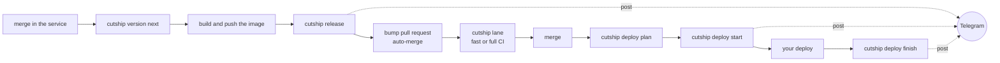

# cutship

cutship runs the release cycle of apps that are deployed from a separate deploy repository. One binary picks the next version from conventional commits, checks that the image was built from that commit, tags the service, opens a bump pull request in the deploy repository with auto-merge, picks the CI lane for it, decides which apps to deploy and whether the deploy can skip CI, records every deploy as a GitHub Deployment, and keeps one live Telegram post per release up to date along the way.

It is for teams that build images in CI, keep image versions in a deploy repository (ansible `app.yml` today; Helm values, kustomize and compose are planned) and deploy from CI without Kubernetes controllers. Everything runs inside your workflows: there is no server and no database.



## Quick start: GitHub and Telegram

This takes about ten minutes. The full walk-through with every setting is in [docs/github-telegram.md](docs/github-telegram.md).

1. Put `cutship.yaml` in the root of the deploy repository:

   ```yaml
   version: 1
   forge:
     type: github
   deploy_repo: acme/deploy
   apps:
     - name: api
       image: ghcr.io/acme/api
       pin: { preset: ansible }
   notify:
     - type: telegram
       chat_id: "-1001234567890"
   ```

   Each app's version lives in the `image` line of `apps/<app>/app.yml`. All fields are in [docs/config.md](docs/config.md).

2. Create the tokens and secrets from [docs/tokens.md](docs/tokens.md): `CUTSHIP_DEPLOY_TOKEN` in the service repository, `TELEGRAM_BOT_TOKEN` in both repositories.

3. In the deploy repository, turn on "Allow auto-merge" and "Automatically delete head branches", and protect the default branch with the required check `lint`.

4. Copy the workflows from [examples/github](examples/github): `release.yml` into the service, `ci.yml`, `deploy.yml` and `notify.yml` into the deploy repository. Replace `acme`, `api` and the deploy step with yours.

5. Check everything from the deploy repository:

   ```bash
   CUTSHIP_DEPLOY_TOKEN=... TELEGRAM_BOT_TOKEN=... cutship validate --online
   ```

6. Merge a `fix:` or `feat:` commit into the service and watch the post appear in the channel.

## Install

In GitHub Actions, `uses: ambrdk/cutship@v0.3.0` or `uses: ambrdk/cutship@<full sha> # v0.3.0` puts that release on `PATH` after checking its checksum. A full SHA is the safer pin; the examples use the version for readability. The Action never builds from source: a commit without a release fails the job. The `version` input installs another release instead.

Elsewhere, download an archive and `checksums.txt` from the [releases](https://github.com/ambrdk/cutship/releases) or run the image `ghcr.io/ambrdk/cutship`. How to verify the cosign signature is in [docs/tokens.md](docs/tokens.md#verifying-a-release).

## Commands

| Command | Where it runs |
|---|---|
| `cutship version next` | service CI, before the image build |
| `cutship release` | service CI, after the image is pushed |
| `cutship lane` | deploy repository CI on pull requests |
| `cutship deploy plan`, `start`, `finish` | deploy repository, on push to the default branch |
| `cutship notify` | deploy repository, optional, on pull request and CI events |
| `cutship validate`, `cutship schema` | anywhere |
| `cutship pin`, `bump`, `gate` | low-level helpers |

Every command, its flags, outputs and exit codes: [docs/commands.md](docs/commands.md). What to do about an error or a warning: [docs/troubleshooting.md](docs/troubleshooting.md).

## Release posts

Each release gets one Telegram post that the commands themselves keep up to date. `cutship release` creates it (📦 waiting for merge), `cutship deploy start` moves it to 🔀 merged and 🚀 deploying, and `cutship deploy finish` ends it with ✅ or ❌ and the hosts from the deploy report. Under the post, in the channel's discussion group, one comment holds the details and a timeline. Both messages are edited in place.

Between runs, the state of each release lives in a hidden comment on the bump pull request (`<!-- cutship:v1 {json} -->`). A deploy that is not a bump keeps its state on the merged pull request it came from, or, for a direct push, in the payload of its GitHub Deployment. Comments of the older `deploy-notify:v1` format are read and rewritten, so posts started before a move keep being edited.

If Telegram fails, the command still does its job and prints a `::warning::` with the reason; the next stage publishes the post with the whole history. Repeated events change nothing: every event has an id, and seen ids are kept in the state.

`release`, `deploy` and `notify` publish with the same bot and are not serialized across repositories. The bot reads `getUpdates` to find the copy of its post in the discussion group, and Telegram allows one reader per token. When another command holds the poll, the bot waits a second and asks again for up to 30 seconds; if the copy still does not show up, the warning says so and the next stage looks for it again. Calls to the messengers in one command stop after two minutes in total, and the state is kept. Each command re-reads the state right before it writes and publishes the newest state it can read; two writes to the same state within the same second can still lose one timeline line or show an older stage until the next event.

## Status

cutship is v0.x: the config and the commands may still change, always with an error that says what to do. 1.0 comes after the whole cycle has run on GitHub with Telegram and on GitLab with Slack, and the config schema has gone through one minor release unchanged.

Planned: GitLab (gitlab.com and self-hosted), Slack, Telegram forum topics, several messengers per release, Helm, kustomize and compose pins, environment promotion, Homebrew.

## Development

```bash
go test -race ./...
bash scripts/pick_tag_test.sh
bash scripts/install_test.sh
go run ./internal/docgen > docs/config.md
```

## License

Apache-2.0, see `LICENSE` and `NOTICE`.
